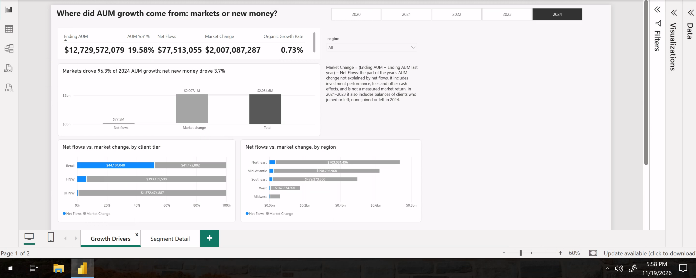
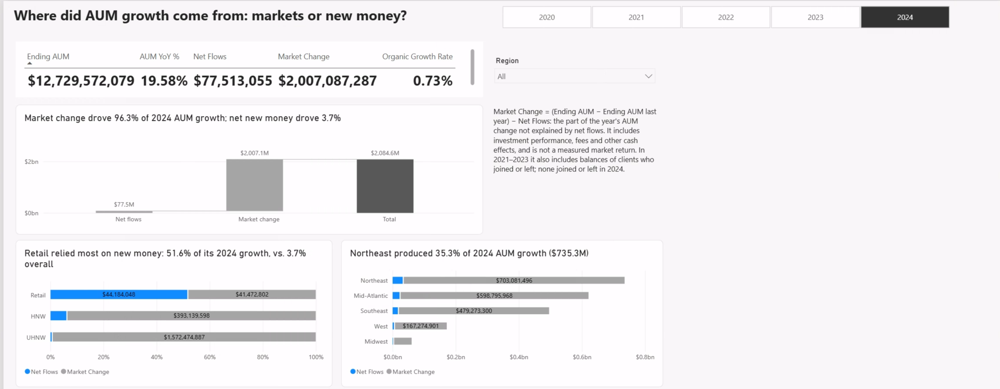

# HW7 Part E: Design critique with Claude

## How I ran it

I started a new Claude Desktop chat with nothing from the earlier prototype chat, so the critique came from the screenshots alone. I attached a screenshot of each page (Page 1: Growth Drivers; Page 2: Segment Detail after drilling through on Retail, 2024) and gave Claude the audience and the question:

- **Audience:** the managing director of Wildcat Capital, who wants a few numbers, a clear answer and the exceptions.
- **Question:** "Where did 2024 growth come from, markets or new money, and which client segments and regions drove it?"

I asked for a critique against the Week 11 checklist (audience and question, visual choice, one accent color, bars from zero, sorting, labels and number formats, insight titles, layout and white space, accessibility, number of visuals) and for the top three changes.

Claude's top three changes were: (1) rebuild the two Page 1 charts to surface the Retail exception, (2) make Page 2 answer the question for the segment, then trim it, and (3) fix numbers, wording, contrast and layout on both pages.

I checked Claude's numbers against the model before deciding. They hold: Retail's $44.2M is 57% of the $77.5M of net flows, Retail holds 4.2% of AUM ($533M of $12.73bn), Retail's flows are 51.6% of its growth, and the top 10 Retail clients hold 1.8% of Retail AUM ($9.79M of $533.45M).

## Decision log

| # | Claude's suggestion | Decision | Reason |
|---|---|---|---|
| 1 | The tier and region chart titles are topic titles ("Net flows vs. market change, by client tier"), not insights | **Accept** (adapted) | Part B asks for insight titles, and only the waterfall had one. I did not use Claude's fixed text, because a typed title goes stale when the year slicer changes. I wrote two dynamic title measures, `Tier Title` and `Region Title` (in `dashboard/insight_title_measures.dax`), and tested them for 2024: "Retail relied most on new money: 51.6% of its 2024 growth, vs. 3.7% overall" and "Northeast produced 35.3% of 2024 AUM growth ($735.3M)". Both match the model |
| 2 | White labels on grey (about 2.4:1) and on bright blue (about 3.2:1) are below the 4.5:1 target | **Accept** | The grey figure checks out for white on `#A6A6A6`. I changed the data labels on both charts to near-black, which is roughly 8:1 on the grey and 6:1 on the blue |
| 3 | The slicer header reads "region" in raw lowercase | **Accept** | One-click fix: the header now reads "Region" |
| 4 | The Page 2 line is smoothed, which implies values between the monthly snapshots | **Accept** | I changed the Interpolation type from Smooth to Linear, so each snapshot is a corner and nothing is drawn between them |
| 5 | "Markets drove 96.3%" overstates what a residual measures | **Adapt** | Right that `Market Change` contains fees and cash effects. I reworded the title to "Market change drove 96.3% of 2024 AUM growth" instead of renaming anything, and kept the on-page caveat. This is also recorded in section 6 of `design_plan.md` |
| 6 | Replace the tier and region charts with Organic Growth Rate bars | **Reject** | Part B requires the net flows vs. market change split by tier and by region, and a growth-rate chart drops it. It would also not show the "57% of net new money" in Claude's own proposed title: a growth-rate bar would show Retail at about 9.9%, not a share of the firm's new money. I kept the split and moved the Retail exception into the title (decision 1) |
| 7 | On Page 2, cut the strip to 3 Card visuals and drop fee yield and alpha | **Reject** | Part C requires five cards (Ending AUM, Ending Clients, Avg AUM per Client, Fee Yield, AUM-Weighted Alpha with Alpha Signal). Card visuals also render blank in Apporto, which is why the strip is a table |
| 8 | Turn the top 10 table's data bars off, or replace the table | **Reject** | Part C requires the top 10 table with conditional formatting. The point that the bars are nearly equal is fair, and is itself the finding: the top 10 are $928K to $1.08M, 1.8% of Retail AUM. The bars start at zero as the checklist asks |
| 9 | Rename `Market Change` to "Market & other change" | **Reject** | The assignment, the reconciliation script and the audit table all use the measure name `Market Change`. Renaming it would break the link between the dashboard and the verification. The caveat on the page explains what it contains |
| 10 | Make Net flows the same blue in the waterfall | **Reject** | The native waterfall colors bars by increase, decrease and total, not by category, and both drivers are increases. The accent stays on the tier and region charts, where Net Flows is blue and Market Change is grey |

## A claim Claude made about my page that was wrong

Claude said Page 2's blue "is a different blue from Page 1". The report file shows otherwise. The data bars are `#118DFF`, the same as Net Flows on Page 1, and the line chart uses the theme's first color, which is also `#118DFF`. Only the back button, a Power BI default, is a different blue.

Smaller mistakes in the same critique:

- It called the "Segment Subtitle" a placeholder to turn off. It is the required dynamic subtitle (`Segment: Retail | Year: 2024`), and only its column header was showing.
- Its `Segment Headline` DAX used table and column names that are not in my model (`DimClient[Tier]`, `DimDate[Year]`); the real ones are `dim_client[client_tier]` and `dim_date[year]`.
- It recommended Card visuals, which render blank in this Power BI setup.

## Before and after

Change shown: the insight titles on the tier and region charts (decision 1), the reworded waterfall title (decision 5), the darker data labels (decision 2) and the "Region" slicer header (decision 3).

**Before**

**After**

The Page 2 change (decision 4) is not in these screenshots. It is visible in the final `dashboard/page2.png`.
